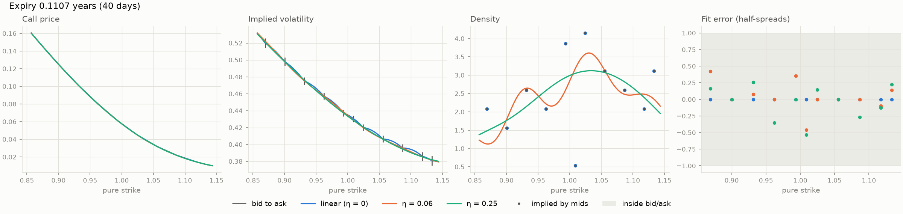
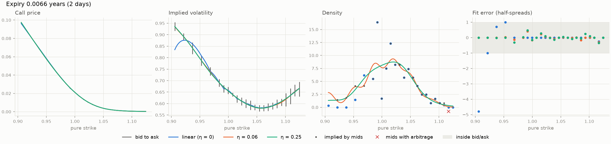
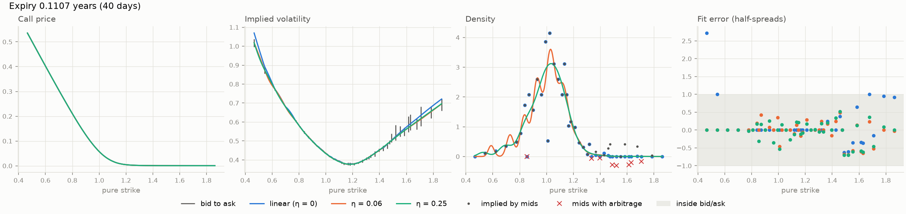
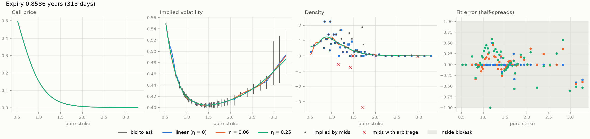
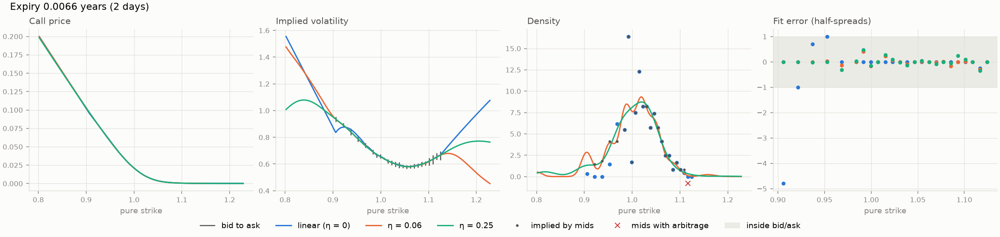
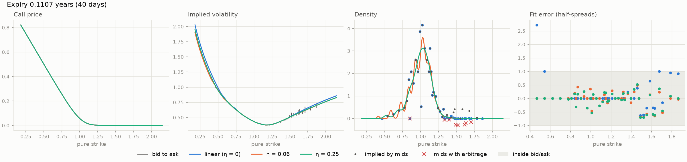
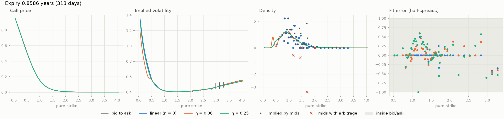

# SANOS on BTC_20261114T223158Z

Produced by `experiments/deribit.py` at commit `90631f6` from `data/deribit/BTC_20261114T223158Z.json` (sha256 `01c7c261334c78cb…`), captured 2026-11-14 22:31:58 UTC.

Quotes after each filter of `sanos.deribit.load`: out-of-the-money quotes 509, no bid 70, bid at the minimum tick 35, expiry too thin 30, kept 374.

Errors are in half-spreads. A miss is a model price outside bid/ask; its size is the distance to the nearer of bid and ask. Prices are pure prices, which for Deribit are BTC; the tick is 0.0001.

| Expiry | Days | Forward | Quotes | Pure strikes | ATM bid vol |
| --- | --- | --- | --- | --- | --- |
| 17NOV26 | 2.4 | 64029 | 24 | 0.91 to 1.12 | 64.1% |
| 18NOV26 | 3.4 | 64035 | 24 | 0.89 to 1.14 | 60.4% |
| 20NOV26 | 5.4 | 64060 | 22 | 0.86 to 1.20 | 57.6% |
| 27NOV26 | 12.4 | 64120 | 29 | 0.78 to 1.42 | 49.4% |
| 4DEC26 | 19.4 | 64202 | 22 | 0.78 to 1.25 | 45.6% |
| 25DEC26 | 40.4 | 64427 | 43 | 0.47 to 1.86 | 43.0% |
| 29JAN27 | 75.4 | 64744 | 53 | 0.77 to 1.85 | 42.0% |
| 26MAR27 | 131.4 | 65297 | 50 | 0.54 to 3.06 | 41.7% |
| 25JUN27 | 222.4 | 66216 | 54 | 0.45 to 3.02 | 41.5% |
| 24SEP27 | 313.4 | 67158 | 53 | 0.52 to 3.28 | 41.4% |

## E1: linear interpolation is too expensive between strikes

The bump is the implied volatility halfway between two neighbouring quoted strikes, minus the average of the implied volatilities at the two strikes, in volatility points. A smile without kinks has bumps near zero.

| Fit | Midpoints | Bump > 0 | Median bump | 10% to 90% |
| --- | --- | --- | --- | --- |
| linear (η = 0) | 364 | 99% | 0.04 | 0.01 to 0.26 |
| η = 0.25 | 364 | 10% | -0.01 | -0.04 to 0.00 |

## E2: η trades smoothness of the density against fit

The last three columns count the local maxima of the model density over the quoted strikes of a short, a mid and a long expiry: 1 is a single hump.

| Fit | Inside bid/ask | Median miss | Worst error | Maxima 17NOV26 | Maxima 25DEC26 | Maxima 24SEP27 |
| --- | --- | --- | --- | --- | --- | --- |
| linear (η = 0) | 97.6% | 4.68 | 8.07 | atoms | atoms | atoms |
| η = 0.06 | 100.0% | none | 1.00 | 3 | 7 | 3 |
| η = 0.25 | 100.0% | none | 1.00 | 1 | 3 | 1 |
| η = 0.5 | 99.7% | 0.22 | 1.22 | 1 | 2 | 1 |

## E3: a full surface fits within bid/ask in under a second

The η = 0.25 fit of all 10 expiries, as one linear program with 1240 model strikes, took 0.30 s including the construction of the program (0.25 s for η = 0.06, 0.05 s for the linear fit).

| Expiry (years) | Quotes | Inside bid/ask | Median miss | Worst error |
|---|---|---|---|---|
| 0.0066 | 24 | 100.0% | none | 0.47 |
| 0.0093 | 24 | 100.0% | none | 0.44 |
| 0.0148 | 22 | 100.0% | none | 0.27 |
| 0.0340 | 29 | 100.0% | none | 0.61 |
| 0.0531 | 22 | 100.0% | none | 0.36 |
| 0.1107 | 43 | 100.0% | none | 0.70 |
| 0.2066 | 53 | 100.0% | none | 0.54 |
| 0.3600 | 50 | 100.0% | none | 0.54 |
| 0.6093 | 54 | 100.0% | none | 0.47 |
| 0.8586 | 53 | 100.0% | none | 1.00 |
| all | 374 | 100.0% | none | 1.00 |

## E4: extrapolation beyond the quoted strikes

Implied volatility of the η = 0.25 fit at the outermost quoted strikes and 2 at-the-money standard deviations beyond them, as strike: volatility. `nan` means the price has no implied volatility in double precision.

| Expiry | Below | Lowest quote | Highest quote | Above |
| --- | --- | --- | --- | --- |
| 17NOV26 | 0.80: 100.8% | 0.91: 93.6% | 1.12: 66.6% | 1.23: 76.4% |
| 25DEC26 | 0.18: 194.7% | 0.47: 101.8% | 1.86: 69.6% | 2.15: 82.9% |
| 24SEP27 | 0.05: 131.8% | 0.52: 54.9% | 3.28: 48.6% | 4.04: 54.5% |

## E5: strictly arbitrage-free for ω = 0

Largest violation of each condition, in price, on 20 expiries (the fitted ones, the midpoints between them, and half the first) times 5000 strikes from 0.02 to 4.91. Fits are with ω = 0 unless stated.

| Fit | Unit mean | Slope in [-1, 0] | Convex in strike | Increasing in expiry |
| --- | --- | --- | --- | --- |
| linear (η = 0) | 9e-16 | 2e-13 | 6e-13 | 6e-16 |
| η = 0.06 | 3e-12 | 1e-13 | 6e-13 | 2e-12 |
| η = 0.25 | 8e-14 | 2e-13 | 5e-13 | 4e-14 |
| η = 0.5 | 6e-13 | 2e-13 | 5e-13 | 3e-13 |
| linear, dense grid | 4e-16 | 2e-13 | 7e-13 | 3e-16 |
| η = 0.25, ω = 1 | 6e-13 | 2e-13 | 6e-13 | 8e-05 |

## E6: mid prices show arbitrage that bid/ask does not

Inner quoted strikes at which the density implied by three neighbouring mids is negative (a butterfly arbitrage at mid prices):

| Expiry | Inner strikes | Negative |
| --- | --- | --- |
| 17NOV26 | 22 | 1 |
| 18NOV26 | 22 | 0 |
| 20NOV26 | 20 | 1 |
| 27NOV26 | 27 | 4 |
| 4DEC26 | 20 | 0 |
| 25DEC26 | 41 | 8 |
| 29JAN27 | 51 | 9 |
| 26MAR27 | 48 | 7 |
| 25JUN27 | 52 | 7 |
| 24SEP27 | 51 | 6 |

Does a fit exist with every model price inside bid/ask, `bid_ask="constrain"`? linear (η = 0): no, η = 0.06: yes, η = 0.25: yes, η = 0.5: no, linear, dense grid: yes. A linear fit is a set of arbitrage-free prices at the quoted strikes (theorem 2.6), so a yes for either linear fit means that arbitrage-free prices exist inside bid/ask. A no does not show an arbitrage: the fit is also restricted by where its model strikes are.
